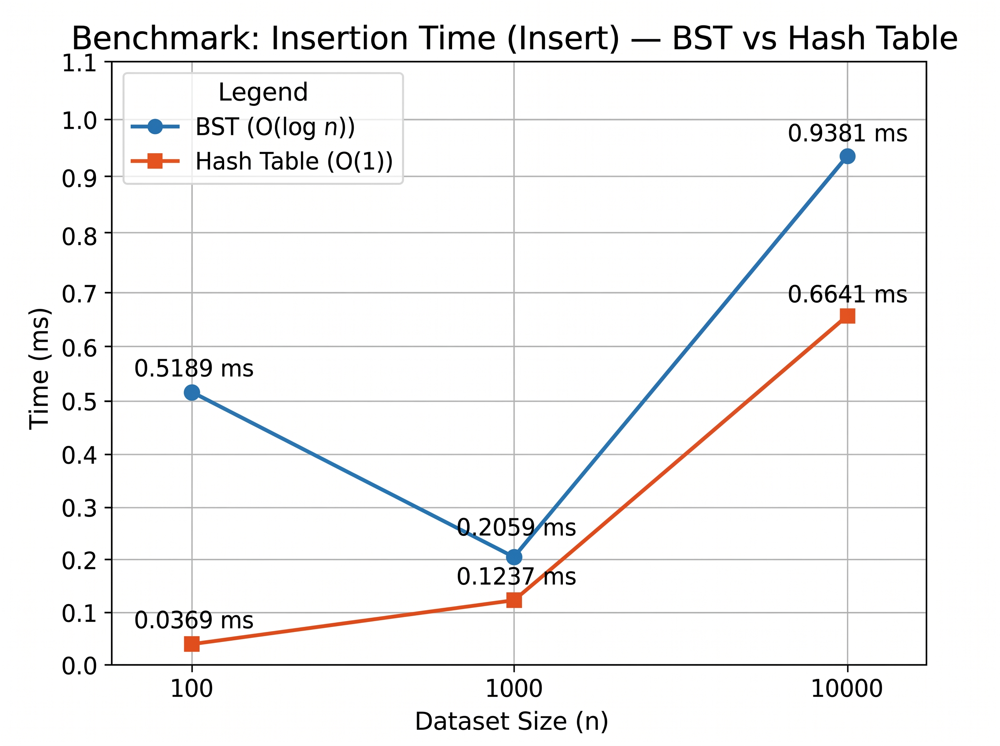
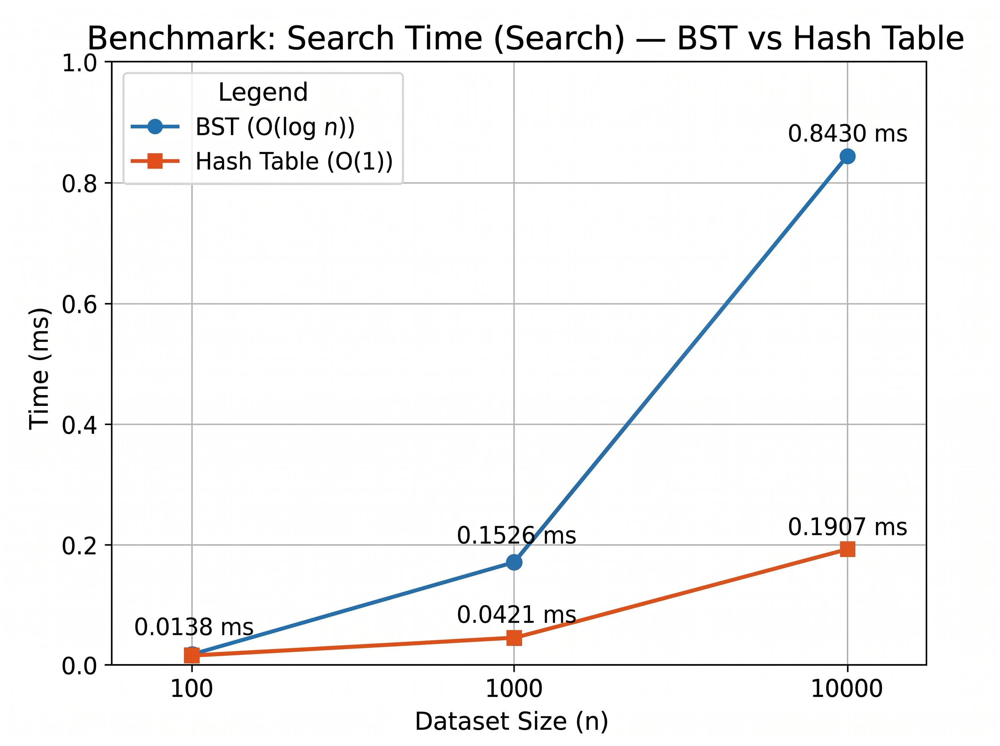
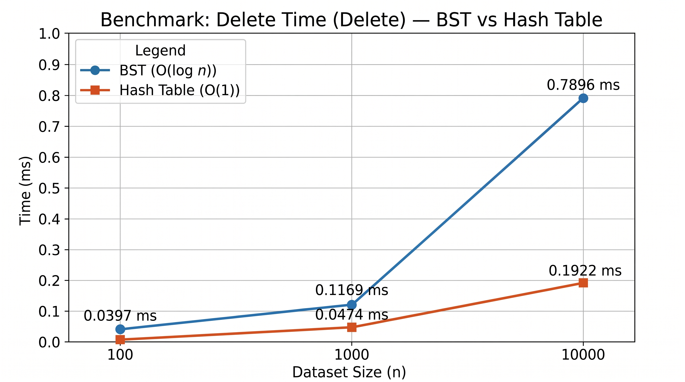
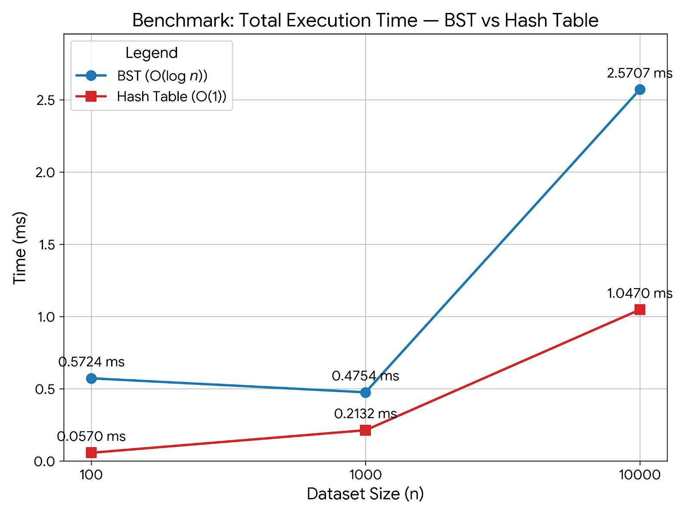

# Binary Search Tree (BST) vs. Hash Table
This project compares the speed of a Binary Search Tree and a Hash Table in Java.

## How They Work
* **Binary Search Tree:** Uses connected nodes (left and right). Insert and search are done using simple loops, and delete uses recursion.
* **Hash Table:** Uses an array of linked lists to handle collisions. When the table gets 75% full, it automatically doubles in size (`resize()`) to keep the operations fast.

## Time Complexity
Here is the theoretical speed for both structures:
| Operation | BST (Average) | BST (Worst) | Hash Table (Average) | Hash Table (Worst) |
| :--- | :--- | :--- | :--- | :--- |
| **Insert** | O(log n) | O(n) | O(1) amortized | O(n) |
| **Search** | O(log n) | O(n) | O(1) | O(n) |
| **Delete** | O(log n) | O(n) | O(1) | O(n) |

* **Average case:** The Hash Table is faster (`O(1)` constant time) than the BST (`O(log n)` logarithmic time). 
* **Worst case:** Both can drop to `O(n)` linear time. For BST, this happens if you insert sorted data, because it builds in straight line. For Hash Tables, it happens if too many items hash to the exact same index.

## Test Results (Seed = 12)
I tested both structures with datasets of 100, 1,000, and 10,000 random numbers. The time is measured in milliseconds (ms).

### 100 elements
| Structure | Insert(ms) | Search(ms) | Delete(ms) | Total(ms) |
| :--- | :--- | :--- | :--- | :--- |
| **BST** | 0.5189 | 0.0138 | 0.0397 | 0.5724 |
| **Hash Table** | 0.0369 | 0.0133 | 0.0068 | 0.0570 |

### 1,000 elements
| Structure | Insert(ms) | Search(ms) | Delete(ms) | Total(ms) |
| :--- | :--- | :--- | :--- | :--- |
| **BST** | 0.2059 | 0.1526 | 0.1169 | 0.4754 |
| **Hash Table** | 0.1237 | 0.0421 | 0.0474 | 0.2132 |

### 10,000 elements
| Structure | Insert(ms) | Search(ms) | Delete(ms) | Total(ms) |
| :--- | :--- | :--- | :--- | :--- |
| **BST** | 0.9381 | 0.8430 | 0.7896 | 2.5707 |
| **Hash Table** | 0.6641 | 0.1907 | 0.1922 | 1.0470 |

## Why the Results Differ in Practice

Looking at the numbers, the Hash Table is much faster, especially on 10,000 elements (1.0470 ms vs 2.5707 ms). Here is why this happens in real life:

* **Math vs. Pointers:** A Hash Table uses a quick math formula to find the exact location of the data instantly. A BST has to travel step-by-step through different nodes (left or right), which takes longer.
* **CPU Cache:** Hash Tables use arrays, which are stored in one solid block of memory. Computers can read this very quickly. BST nodes are allocated randomly across the memory, which slows down the computer.
* **Java Warm-up (JIT):** You might notice that inserting 100 elements in the BST (0.51 ms) actually took longer than 1,000 elements (0.20 ms). This is because Java runs a bit slower at the very beginning while it "warms up" and translates the bytecode. After the first small test, it speeds up significantly for the bigger datasets.

**Conclusion:** Use a Hash Table when you need maximum speed for finding and adding items. Use a BST only if your project requires you to keep the data sorted at all times.

## Visual Comparison
Below are the graphical representations of the benchmark results for each individual operation and the total execution time.

### Insert Operation

### Search Operation

### Delete Operation

### Total Execution Time

